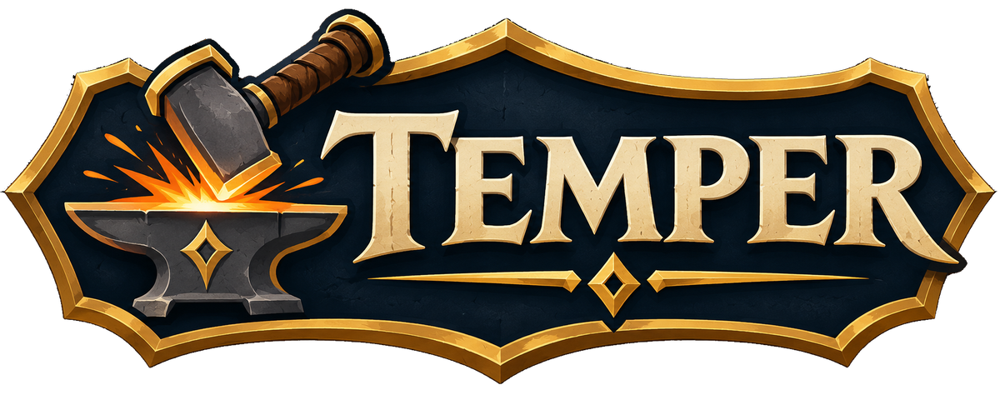

# Temper

An addon for World of Warcraft: Forever that helps you understand how your
character fights: where your damage comes from, what's holding it back,
how well you keep yourself going, and whether the change you just made
actually helped.

To temper steel is to test it and make it harder. Same idea.

## Why I made it

Most damage meters are built for competition. They rank you against the
rest of the group, put a number on who pulled their weight, and get pasted
into chat after a pull. That has its place, but it was never what I wanted
from one. I wanted to know how my own character works: which abilities
are carrying me and which are wasted presses, whether the rotation I've
settled into is any good, whether that new sword is really better than
the old one, or if the talent I swapped into was worth it.

The answer to those questions is all there in the fight, but nothing lays
it out for you. So Temper keeps a quiet record of every fight you have on
your own, and turns it into something you can read and act on:

- **Your rotation, laid bare.** Every ability's share of the damage, what
  each press and each point of mana or energy bought, a strip of what you
  used in order, and a few plain sentences on what to work on.
- **Your build, put to the test.** Compare one set of fights with another
  to see what a piece of gear, a talent or a new habit changed. Or run an
  experiment: a few fights before, a few after, and a verdict that tells
  you how far to trust it.
- **Your progress, against nobody but yourself.** Your bests, and how
  each day's typical fight compares with the last.

I also never liked the damage numbers, the game's or anyone else's. They
burst out of the middle of the screen, pile on top of each other, and are
gone before you can read them. Temper puts yours in a tidy column beside
the enemy's nameplate, each with the icon of the ability that dealt it, so
a glance tells you what hit and how hard without your screen filling up.

**It's about you, and it stays with you.** Temper looks only at your own
fighting. It doesn't rank you against anyone, it doesn't measure other
players, and it has nothing to say about a group. It never posts to chat,
never sends anything to other players or to any server, and has no way to
share or export what it records. Your fights are kept in your own saved
game data and nowhere else.

There is nothing to set up. Install it, fight something, and click the
small panel that appears.

[What's new](CHANGELOG.md) ·
[Report a problem](https://github.com/flightpathlabs/Temper/issues/new/choose)

## Installing

1. Open [Releases](https://github.com/flightpathlabs/Temper/releases) and,
   from the newest one, download the file whose name starts with
   `Temper-v`. Not "Source code": that one unpacks under the wrong folder
   name and the game won't see it.
2. Unzip it into your game's addon folder:
   `World of Warcraft\_forever_\Interface\AddOns\`
   You should end up with `AddOns\Temper\Temper.toc`.
3. Start the game, or type `/reload` if it's already running. On the
   character screen, check that Temper is ticked under **AddOns**.

To update, do the same again and let it replace the old folder. Your
fights live with your game settings, not in the addon folder, so they
stay.

If you use git, clone it into the addon folder and update with
`git pull`. Work in progress is on the `dev` branch.

```
git clone https://github.com/flightpathlabs/Temper.git
```

## Your first few fights

1. Make sure enemy nameplates are on (V). Temper's numbers sit beside
   them.
2. Fight something. Your hits appear by the enemy's nameplate, and a small
   panel shows the fight as it goes.
3. When it's over, the panel shows the exact figures. Click it to open the
   window and read the fight in full.

Temper gets more useful the more you fight: a few fights give you a
typical DPS to measure against, and a few days give you a column for each
on the Progress tab.

## A look around

### The numbers

Your hits appear in a column by each enemy's nameplate and follow it
around, in place of numbers flying all over the screen. By default they
sit to the right of the nameplate, each with its ability's icon, and step
up a line as new ones arrive, like a short log. A bleed or other effect
that ticks gets a small dot instead of an icon.

Weapon swings are white, abilities yellow, magic the colour of its school
and a pet's blows green. Critical hits are larger, red, and land with a
pop. Misses, dodges and parries show as small words. Hits that were most
likely someone else's, on an enemy you're both fighting, are drawn small
and faint in a column of their own.

All of it can be changed: how the numbers move, how long they stay, which
side they sit on, their size and their font. While the options are open an
example enemy stands beside the window with made-up hits playing on it, so
every change can be judged as it's made.

### The fight panel

A small panel shows your DPS, damage, hits, crits and misses as the fight
goes, and the last fight's exact figures in between, with an arrow saying
how it compares with your typical fight. Under that are your last few
fights and your figures for the session so far. The stopwatch in its top
right corner starts and ends a session, and the cog beside it opens the
options. Right-click it for a short menu of what it shows; drag it
anywhere.

Small icons along its bottom light up for what you have going for you:
rested experience, food, an elixir or flask, a scroll, a stone or oil on
your weapon, your class's own buff, and the buffs other players give.
Rest the mouse on the last to see which classes' buffs you're missing.

Just above it, a short note says when you're not ready for a fight: a
fishing pole still in hand, a buff of your class's own not up, no poison
or imbue on your weapon, ammunition running low, gear about to break, or a
pet that's away, dead or unhappy.

A second panel like it shows your healing. It can be put away from the
fight panel's menu or the options. Both panels come in a normal and a
large size.

### Alerts during a fight

**The ability alert,** off until you switch it on, shows an ability's icon
below the middle of the screen when something has made it your best next
press: Clearcasting, say, or Overpower after an enemy dodges. It glows,
plays one of the game's alert sounds as it appears, and goes once it's used
or the moment passes.

**Combo points,** for rogues and druids in cat form, show as a row of
small pips under your target's nameplate, lit as you build them.

### Fights

Every solo fight is kept, the latest 200 for each character. The list on the left names each by what it was
against: the boss if there was one, otherwise the enemy, or the kind of
enemy for a pull of several ("Webwood Spider ×4"). Elites and rares are
marked, and each shows the enemy's level (an average, for a pull of mixed
levels) and how long the fight lasted.
The box at the top finds fights by enemy name.

Click a fight to read it. Shift-click selects a run of fights and
Ctrl-click adds one; the page covers whatever is selected. Right-click for
more, such as leaving a fluke out of your averages. The page shows:

- your DPS, damage, length and crit rate along the top;
- how much each ability did, with its icon, its share, and what each use
  and each point of mana or energy bought;
- every way an attack failed, counted separately: missed, dodged, parried;
- a few plain sentences about what to work on: a weapon skill that's
  behind the enemies you're fighting, an ability that keeps getting
  parried, time spent with nothing in use;
- a strip of what you used, in order, with crits and misses marked;
- the biggest hit and biggest critical hit.

### Healing and defence

Each fight also keeps how much you healed and with what, who healed you
(you, your pet, or a passer-by outside your group), the damage you took
and what it came from, what your shields soaked up, and how many casts you
interrupted and effects you dispelled.

It also works out how much of the damage coming at you was stopped, and
how: by your armour, by blows you dodged, parried or that missed, and by
your shield. Where something would help, it says so: armour that has
fallen behind your level, say, or a defence skill behind the enemies you
fight.

The fight page sums it up in a line or two. The Healing and defence tab
breaks it down for the last fight, the session or everything on record.

### Comparing

Select some fights, press **Compare with...**, click the fights to set
them against, and press **Done**. Every figure shows how far it moved,
with the gear that changed listed underneath. Whichever set is older is
treated as the "before", so green always means you improved.

### Experiments

For a straight answer to "is this better?": press **New experiment**, say
what you're trying, and follow the three steps. Temper records a few
fights as you are, waits while you make your change, records a few more,
and gives a verdict that says how far to trust it. The panel tells you
when it's your move.

### Progress

Your bests, and a column for each day you've played, measured against
nobody but yourself. Click a best to open the fight it came from.

### Sessions

A session marks a run of fights, so they can be selected with one click
and compared with another run. Start one from the stopwatch on the panel,
the window, `/temper session` or a key under Options > Keybindings >
Temper. Type a note on it to remember what you changed. Fights are kept
whether you're in a session or not.

### Help

The About tab answers the common questions, says what Temper can and
can't see, and has a button for reporting a problem.

## How it decides

Wherever fights are averaged (the panel's arrow, several fights on the
Fights tab, comparisons, experiments and the day-by-day columns), the
figure is a typical one, not a plain average:

- Fights that would only mislead are left out: those over in under six
  seconds, those won mostly by an item, those you've left out by hand,
  and those against critters or enemies too weak to give you experience.
  Those flatter your damage.
- From three fights up, the highest and lowest are set aside before the
  rest are averaged, so one fluke at either end can't tip it. With three
  or four fights that leaves the median; from twenty up, a tenth is set
  aside from each end.

Rest the mouse on the figure to see how many fights it went by.

## What it can and can't know

Forever closes the combat log to addons, so Temper works from what the
game still offers. That shapes what it shows.

| It knows exactly | Because |
|---|---|
| Damage by ability, per fight | The game tallies it and lets addons read the tally when a fight ends |
| DPS and fight length | From the same tally and the length of the fight |
| Hits, critical hits, misses, dodges, parries | The game reports each blow on an enemy as it lands |
| How many times you used each ability, and when | The game reports your own casts |
| What each ability costs, and so its damage per point of mana or energy | The game says what an ability costs; the rest is division |
| Healing by ability, damage taken by enemy ability, absorbs, interrupts and dispels, per fight | The game keeps tallies of these alongside its damage tally. Only healing done during a fight is in them; eating or bandaging between fights isn't |
| Your skill with the weapon in hand, and what a shortfall costs | The game shows it on the character sheet, and its own skills window gives the sums |

| It works out, and says "about" | How |
|---|---|
| How hard each blow landed, and so your biggest hit and biggest crit | An enemy's threat towards you rises by the damage of each blow, and the game lets addons read that. Blows that land close together can't be told apart, so not every blow is sized |
| Which ability a blow was, and whether each use landed | From what you had just used and the kind of damage |
| Whether a hit was someone else's | A blow on an enemy that didn't raise its threat towards you, when you hadn't just acted, most likely wasn't yours |
| How much of the damage coming at you was stopped: by armour, by blows dodged, parried or missed, by your shield | The character sheet says what your armour takes off a blow and what your shield blocks, and every enemy blow that missed is counted. A blow that didn't land is valued at an average one that did. Resisted spells are counted but not valued: the game doesn't say by how much |

| It can't know | Because |
|---|---|
| Your running damage during a fight | The game lets an addon show it but not read it. The panel shows it; the exact figures arrive when the fight ends |
| How much mana or energy you have left | Hidden. Temper counts the times the game says you hadn't enough |
| Whose hit it was, in a group | The game doesn't say, which is why Temper keeps to solo play |
| Some buffs, in a fight | The game hides them from addons in a fight. For the ability alert, Temper asks the game to draw those itself, which it can do without telling Temper anything |

Numbers are drawn above your target and any other enemy that is fighting
you. A stranger's fight nearby is left alone. They follow each enemy's
nameplate, so enemy nameplates need to be on; with them off, the numbers
appear in the middle of the screen.

## In a group

Temper is for playing on your own. In a group the game no longer lets it
tell your hits from anyone else's, so it steps aside: no numbers of its
own and no record, and the game's own damage numbers come back. The
ability alert and the combo points still show, since they're only about
your own next move.

## Blizzard's damage numbers

While Temper's column is showing, it switches the game's own damage
numbers off so each hit isn't shown twice, and puts your setting back when
it steps aside and when you log out. You can turn this off in the options.

Your setting is kept in Temper's saved data, so it's put back correctly
even if the game closed badly while the numbers were off. If you remove
Temper straight after a crash and find them missing, turn them back on
under Options > Combat.

## Commands

| | |
|---|---|
| `/temper` | Open or close the window |
| `/temper session` | Start or end a session |
| `/temper options` | Open Temper's options |
| `/temper example` | Show or hide the example enemy |
| `/temper check` | Say what Temper can see on this character: which of your alerts the game lets it watch in a fight, and the like |
| `/temper report` | Gather what a bug report needs, ready to copy |

Temper is also in the addon list by the minimap: left-click opens the
window, right-click the options. Options are in the game's own Options
window, under AddOns > Temper, and the cog on the panel or in the
window's title bar takes you there. At the foot of that page, **Forget
everything** starts you again from nothing, after asking.

## When something goes wrong

Type `/temper report` in game, or press **Report a problem** on the About
tab. It gathers what's needed to track a fault down (versions, your
settings, the game settings that change what Temper can show, other
addons that draw numbers or dress up nameplates, and any errors) into a
box you can copy. It includes no character names or realm, and you can
read it before you send it.

Then [open a report](https://github.com/flightpathlabs/Temper/issues/new/choose)
and paste it in. Ideas are welcome at the same address.

## For contributors

Work happens on `dev`, and that's the branch to base a pull request on.
`main` only moves when a release is made. Changes are noted under
"Unreleased" in [CHANGELOG.md](CHANGELOG.md) as they're made.

```
Core/      startup, events, saved data and its defaults
Combat/    what happens in a fight: hits, casts, the game's tallies, procs, readiness, defence
Text/      the damage numbers by each nameplate
Record/    the fights on record, and the sums done over them
UI/        the panels, the window and its tabs, the alerts and the options
Media/     icon and portrait
```

Lua 5.1, no libraries. Files load in the order listed in `Temper.toc`,
and each group only uses what the groups above it define. The game says
nothing about a file that exists but isn't listed, and files newly added
to the TOC need a full restart of the game, not a `/reload`. Modules talk
to each other through the small message bus in `Core/Events.lua`; the
list of messages is at the bottom of that file.

Formatting is StyLua and linting is luacheck. From the addon folder:

```
stylua .
luacheck .
```

## Disclaimer

Temper is a fan-made addon. World of Warcraft and related names and
artwork are trademarks of Blizzard Entertainment. This project is not
affiliated with or endorsed by Blizzard Entertainment.

## Licence

MIT. See [LICENSE](LICENSE).

<p align="center">
  <a href="https://github.com/flightpathlabs"></a>
</p>
